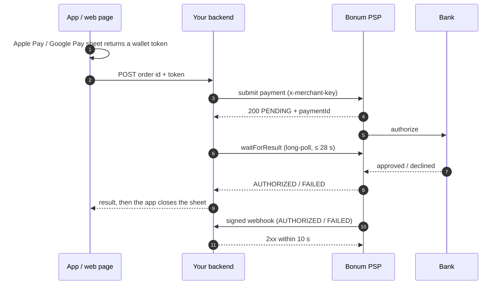

# bonum-psp

**English** | [Монгол](https://github.com/Jack-infinite/bonum-psp/blob/main/packages/sdk/README.mn.md)

[](https://www.npmjs.com/package/bonum-psp)
[](https://github.com/Jack-infinite/bonum-psp/actions/workflows/ci.yml)
[](./LICENSE)

> **Unofficial — not affiliated with or endorsed by BONUM LLC.** This is a community SDK. For the
> API itself, Bonum's [V2 documentation](https://psp.bonum.mn/v2/integration-guide.html) is the
> source of truth.

TypeScript SDK for **Bonum PSP V2**: submit Apple Pay and Google Pay payments from your server, get
the bank's answer, and verify Bonum's webhooks.

- [Features](#features) · [Install](#install) · [How V2 works](#how-bonum-v2-works) ·
  [Quick start](#quick-start) · [Apple Pay](#apple-pay-flow) · [Google Pay](#google-pay-flow)
- [Webhooks](#webhooks) · [Idempotency and reconciliation](#idempotency-and-reconciliation) ·
  [Errors](#error-handling) · [Configuration](#configuration-reference)
- [Testing](#testing-your-integration) · [Tunnels](#local-webhook-testing-through-a-tunnel) ·
  [Security](#security-notes) · [Signature mismatch?](#troubleshooting-signature-mismatch) ·
  [FAQ](#faq)

## Features

- **All five V2 endpoints, typed:** Apple Pay and Google Pay submission, lookup by `paymentId` or
  by your order id, and the long-poll that waits for the bank.
- **Webhook verification:** HMAC-SHA256 with a constant-time check, the 300-second replay window,
  typed events and secret rotation.
- **Ready-made webhook handlers:** one Fetch API handler (Next.js, Hono, Cloudflare Workers, Bun,
  Deno) and an Express adapter (Express 4 and 5).
- **Testing helpers:** realistic events and correctly signed webhooks for your own tests.
- **Careful HTTP:** timeouts, cancellation with `AbortSignal`, and retries with backoff. Retrying a
  submission is safe because Bonum treats `order_id` as an idempotency key.
- **Errors you can act on:** specific classes with stable `code` values and messages that say what
  to do next.
- **Zero runtime dependencies.** ESM only, with full type declarations.

## Install

```bash
npm install bonum-psp
# or: pnpm add bonum-psp · yarn add bonum-psp · bun add bonum-psp
```

## Requirements

- **Node.js 22.12 or later.** On Node 22.12+, CommonJS projects can `require('bonum-psp')` too.
  The SDK uses only Web-standard APIs (`fetch`, Web Crypto, `AbortSignal`), so it is built to run
  on Bun, Deno, Cloudflare Workers and Vercel Edge as well. CI tests Node 22, 24 and 26.
- **Server-side only.** The merchant key is a secret, so `new BonumClient()` refuses to run in a
  browser. Your app or web page talks to _your_ backend, and only your backend talks to Bonum.
  (Some of Bonum's own JavaScript samples call the API straight from the browser. Don't copy that
  part.)

## How Bonum V2 works

Submitting a payment does not give you the bank's answer. Bonum accepts the wallet token, replies
`PENDING` right away, and asks the bank in the background. The answer reaches you in two ways that
run in parallel:

- **The await endpoint:** your backend holds a request open (up to 28 s) until the bank answers.
  Use it to close the wallet sheet with the real result.
- **A webhook:** Bonum POSTs a signed event to your server. Unlike the wallet sheet, it does not
  depend on the customer staying on the page, and Bonum retries it.



Statuses:

| Status       | Meaning                                 | What to do                                                            |
| ------------ | --------------------------------------- | --------------------------------------------------------------------- |
| `PENDING`    | Accepted, the bank has not answered yet | Show "processing". **It is not a failure.** Never fulfil.             |
| `AUTHORIZED` | Approved, funds reserved                | Fulfil the order (once).                                              |
| `FAILED`     | Declined or a processing error          | Show `failureReason`. The customer may try again with a new order id. |

## Quick start

```ts
import { BonumClient } from 'bonum-psp';

// Reads BONUM_MERCHANT_KEY, BONUM_ENV and (optionally) BONUM_WEBHOOK_SECRET from the environment.
const bonum = new BonumClient();

const payment = await bonum.payments.getByOrderId('ORD-1001');
console.log(payment.status); // 'PENDING' | 'AUTHORIZED' | 'FAILED'
```

| Variable               | Used for                                                                                                              |
| ---------------------- | --------------------------------------------------------------------------------------------------------------------- |
| `BONUM_MERCHANT_KEY`   | Every API call (the `x-merchant-key` header). Bonum issues it during onboarding.                                      |
| `BONUM_ENV`            | `sandbox` (`https://testpsp.bonum.mn`) or `production` (`https://psp.bonum.mn`). **Required:** the SDK never guesses. |
| `BONUM_WEBHOOK_SECRET` | Webhook verification. Bonum issues it when you register your webhook URL.                                             |

You can pass all of them as options instead (see [Configuration](#configuration-reference)).

## Apple Pay flow

1. Your app or web page shows the Apple Pay sheet. When the customer authorizes, it receives a
   `PKPaymentToken` (Apple Pay JS: `event.payment.token`).
2. It POSTs the token and the order id to your backend, unchanged.
3. Your backend decides the amount, submits the payment, and waits for the bank within one deadline
   that fits the roughly 30 seconds the sheet stays open.
4. The app closes the sheet: success for `AUTHORIZED`, failure for `FAILED`. A sheet only knows
   success and failure, so for `PENDING` it closes with failure too, as in Bonum's guide. Then the
   app shows its own "processing" screen and the webhook settles the order. Never tell the customer
   that a `PENDING` payment failed: it may still go through, and they might pay again.

```ts
import {
  type ApplePayPaymentToken,
  BonumClient,
  BonumValidationError,
  isBonumError,
} from 'bonum-psp';
import express from 'express';

const bonum = new BonumClient();
const app = express();
// Register the webhook route (see below) before this, so it still gets the raw body.
app.use(express.json());

app.post('/payments/apple-pay', async (req, res) => {
  const { orderId, token } = req.body as { orderId: string; token: ApplePayPaymentToken | string };
  const order = await findOrder(orderId); // your database: the amount comes from here, never the app
  if (order === undefined) {
    res.status(404).json({ error: 'unknown_order' });
    return;
  }

  // One deadline for submit + wait, inside the time the wallet sheet stays open.
  const deadline = Date.now() + 25_000;
  const signal = AbortSignal.timeout(25_000);
  try {
    const submission = await bonum.payments.submitApplePay(
      { orderId: order.id, token, amount: order.amount },
      { signal, timeoutMs: 8_000 },
    );
    await savePaymentId(order.id, submission.paymentId);

    const waitMs = Math.max(1, Math.min(20_000, deadline - Date.now() - 2_000));
    const result = await bonum.payments.waitForResult(submission, { waitMs, signal });
    res.json({ status: result.status, failureReason: result.failureReason });
  } catch (error) {
    if (error instanceof BonumValidationError) {
      res.status(400).json({ error: 'invalid_request', field: error.field });
      return;
    }
    // A timeout or network error leaves the outcome unknown: keep the order PENDING and let the
    // webhook or your reconciliation job settle it. Never tell the customer it failed.
    console.error('Bonum submission problem:', isBonumError(error) ? error.code : error);
    res.status(202).json({ status: 'PENDING' });
  }
});
```

`token` may be the `PKPaymentToken` object or its JSON string. Mobile bridges often deliver a
string, and the SDK parses it. The token is sent to Bonum exactly as received. Apple Pay requests
carry no currency: it comes from the token. A complete, type-checked version of this server is in
[`examples/express`](https://github.com/Jack-infinite/bonum-psp/tree/main/examples/express).

## Google Pay flow

The flow is the same. The app takes `paymentData.paymentMethodData.tokenizationData.token` (a
string) from the Google Pay result and sends it to your backend. Your backend then names the
currency, which must be `MNT`, `USD`, `EUR` or `JPY`:

```ts
const submission = await bonum.payments.submitGooglePay(
  { orderId: order.id, token, currency: 'MNT', amount: order.amount },
  { signal, timeoutMs: 8_000 },
);
const result = await bonum.payments.waitForResult(submission, { waitMs, signal });
```

Use the same deadline and error handling as for Apple Pay. Setting up the wallets themselves
(Apple merchant IDs, domain verification, Google Pay merchant registration) is outside this SDK:
follow Bonum's wallet guides.

## Webhooks

You register an **HTTPS** webhook URL with Bonum (in their dashboard or through support), and Bonum
gives you the signing secret. What your endpoint must do:

1. Read the **raw** request body: the exact bytes, not a parsed and re-serialized object.
2. Verify the signature before doing anything else. The SDK checks `X-PSP-Signature`
   (`v1=<hex>`, HMAC-SHA256 over `` `${timestamp}.${rawBody}` ``) and that `X-PSP-Timestamp` is
   within 300 seconds of your clock.
3. Answer **2xx within 10 seconds**. Bonum treats anything else as a failed delivery and tries
   up to five times in total: right away, then after about 1 minute, 5 minutes, 30 minutes and
   2 hours. After that only a lookup recovers the result.
4. Store the event, answer, and do the slow work (emails, fulfilment) in the background. Answer
   duplicates with 200, never 4xx.

The handlers below answer for you: 400 `{ "error": "<reason>" }` for a webhook that fails
verification, 500 when your `onEvent` throws (so Bonum retries), and 200 otherwise. A correctly
signed event of a type this SDK does not know yet also gets 200, with `"ignored": true`, so Bonum
does not retry it forever.

```ts
import type { BonumWebhookEvent } from 'bonum-psp';

async function saveEvent(event: BonumWebhookEvent): Promise<void> {
  // event.eventType is 'AUTHORIZED' | 'FAILED'; TypeScript narrows on it.
  // Dedupe and store it; see "Idempotency and reconciliation".
}
```

### Express 5

```ts
import express from 'express';
import { BonumClient } from 'bonum-psp';
import { expressWebhookHandler } from 'bonum-psp/express';

const bonum = new BonumClient();
const app = express();

// Before any app-wide express.json(): that would parse the body, and the signature could no
// longer be checked.
app.post(
  '/webhooks/bonum',
  express.raw({ type: 'application/json' }),
  expressWebhookHandler({ webhooks: bonum.webhooks, onEvent: saveEvent }),
);

app.use(express.json());
```

The adapter needs no `express` types and also works with Express 4. If the body was already
parsed, it passes a `BonumConfigError` that names the fix to `next()`. The result is a 500, so
Bonum keeps retrying until the fix is deployed. Only verifying webhooks? `expressWebhookHandler({ onEvent })`
reads `BONUM_WEBHOOK_SECRET` and needs no merchant key.

### Next.js App Router

```ts
// app/api/webhooks/bonum/route.ts
import { BonumWebhooks } from 'bonum-psp';
import { saveEvent } from '@/lib/events';

let handler: ((request: Request) => Promise<Response>) | undefined;

export function POST(request: Request): Promise<Response> {
  // Created on the first request rather than at import time, so `next build` runs without
  // BONUM_WEBHOOK_SECRET.
  handler ??= new BonumWebhooks().createHandler({ onEvent: saveEvent });
  return handler(request);
}
```

Route handlers receive the untouched `Request`, so no body-parser setup is needed. See
[`examples/nextjs-app-router`](https://github.com/Jack-infinite/bonum-psp/tree/main/examples/nextjs-app-router).

### Hono

```ts
import { Hono } from 'hono';
import { BonumWebhooks } from 'bonum-psp';

const handler = new BonumWebhooks().createHandler({ onEvent: saveEvent });
const app = new Hono();

app.post('/webhooks/bonum', (c) => handler(c.req.raw)); // don't read the body before this
```

On Cloudflare Workers, secrets arrive as bindings rather than environment variables, so pass the
secret explicitly: `new BonumWebhooks({ secret: c.env.BONUM_WEBHOOK_SECRET })`.

### Fastify

Fastify parses JSON for every route by default. Keep the raw bytes for the webhook route only, by
giving it its own plugin scope:

```ts
import Fastify from 'fastify';
import { BonumWebhookError, BonumWebhooks } from 'bonum-psp';

const webhooks = new BonumWebhooks();
const app = Fastify();

app.register(async (scope) => {
  // Applies to routes in this plugin only: JSON bodies stay raw Buffers here.
  scope.addContentTypeParser('application/json', { parseAs: 'buffer' }, (_req, body, done) => {
    done(null, body);
  });

  scope.post('/webhooks/bonum', async (request, reply) => {
    try {
      const event = await webhooks.verify(request.body as Buffer, request.headers);
      await saveEvent(event);
      return { received: true };
    } catch (error) {
      if (!(error instanceof BonumWebhookError)) throw error; // 500: Bonum retries
      if (error.reason === 'unsupported_event_type') return { received: true, ignored: true };
      return reply.code(400).send({ error: error.reason });
    }
  });
});
```

### NestJS

Turn on Nest's raw body support, then verify `req.rawBody`:

```ts
// main.ts
const app = await NestFactory.create(AppModule, { rawBody: true });
```

```ts
// bonum-webhook.controller.ts
import { BadRequestException, Controller, HttpCode, Post, type RawBodyRequest, Req } from '@nestjs/common';
import type { Request } from 'express';
import { BonumWebhookError, BonumWebhooks } from 'bonum-psp';

@Controller('webhooks/bonum')
export class BonumWebhookController {
  private readonly webhooks = new BonumWebhooks();

  @Post()
  @HttpCode(200)
  async receive(@Req() req: RawBodyRequest<Request>) {
    if (req.rawBody === undefined) throw new Error('Create the app with { rawBody: true }.');
    try {
      const event = await this.webhooks.verify(req.rawBody, req.headers);
      await saveEvent(event);
      return { received: true };
    } catch (error) {
      if (!(error instanceof BonumWebhookError)) throw error; // 500: Bonum retries
      if (error.reason === 'unsupported_event_type') return { received: true, ignored: true };
      throw new BadRequestException({ error: error.reason });
    }
  }
}
```

### Anything else

`webhooks.verify(rawBody, headers)` takes the raw body as a `string`, `Uint8Array` (Node's `Buffer`)
or `ArrayBuffer`. Headers can be a `Headers` object or Node's `req.headers`. It returns the typed
event or throws a `BonumWebhookError` whose `reason` says what was wrong. For Fetch API runtimes,
`webhooks.verifyRequest(request)` reads the body for you, and `webhooks.createHandler()` is the
complete handler.

## Idempotency and reconciliation

Plan for every event to arrive more than once, and for some never to arrive. Use two levels of
protection:

1. **Dedupe deliveries on `webhookId`** with a unique index. A repeated delivery gets 200 and is
   not processed again.
2. **Make each payment's transition happen once.** Move a payment out of `PENDING` with a
   conditional update, and fulfil only when that update changed something. Bonum's documentation
   leaves open whether a retry keeps its `webhookId`. Besides, the same answer can reach you from
   the webhook, from `waitForResult` and from a lookup, in any order.

A **reconciliation job** closes the gap when the webhook never arrives, for example while your
server was down for all five attempts. Every few minutes, it looks up payments that are still
`PENDING` and applies the same conditional update.

With MongoDB:

```ts
import { type BonumWebhookEvent, BonumClient, type PaymentStatus } from 'bonum-psp';
import { MongoClient, MongoServerError } from 'mongodb';

interface OrderDoc {
  orderId: string;
  paymentId: string | null; // saved when the submission returns
  status: PaymentStatus;
  submittedAt: Date | null;
}

const bonum = new BonumClient();
const db = new MongoClient(process.env.MONGODB_URL ?? 'mongodb://localhost:27017').db('shop');
const events = db.collection<BonumWebhookEvent>('bonum_webhook_events');
const orders = db.collection<OrderDoc>('orders');
await events.createIndex({ webhookId: 1 }, { unique: true });

/** Moves a payment out of PENDING once. Returns true only for the call that did it. */
async function settle(paymentId: string, status: 'AUTHORIZED' | 'FAILED'): Promise<boolean> {
  const { modifiedCount } = await orders.updateOne(
    { paymentId, status: 'PENDING' },
    { $set: { status } },
  );
  return modifiedCount === 1;
}

/** The webhook's onEvent. */
export async function saveEvent(event: BonumWebhookEvent): Promise<void> {
  try {
    await events.insertOne(event); // level 1: the unique index rejects a repeated delivery
  } catch (error) {
    if (error instanceof MongoServerError && error.code === 11000) return; // duplicate: answer 200
    throw error; // 500: Bonum retries
  }
  // Level 2: whichever of webhook, waitForResult or the job comes first wins; the rest are no-ops.
  if ((await settle(event.paymentId, event.status)) && event.status === 'AUTHORIZED') {
    await enqueueFulfilment(event.orderId); // slow work happens elsewhere
  }
}

/** Run every few minutes. */
export async function reconcilePendingPayments(): Promise<void> {
  const cutoff = new Date(Date.now() - 10 * 60_000);
  for await (const order of orders.find({ status: 'PENDING', submittedAt: { $lt: cutoff } })) {
    if (order.paymentId === null) continue; // see below
    const payment = await bonum.payments.get(order.paymentId);
    if (payment.status === 'PENDING') continue;
    if ((await settle(payment.paymentId, payment.status)) && payment.status === 'AUTHORIZED') {
      await enqueueFulfilment(payment.orderId);
    }
  }
}
```

With SQL, the conditional update is
`UPDATE orders SET status = $1 WHERE payment_id = $2 AND status = 'PENDING'`, and you check the
affected row count.

If your server stopped between submitting and saving the `paymentId`, find the payment with
`bonum.payments.getByOrderId(orderId)`. Submitting the same `order_id` again is also safe: Bonum
returns the original payment instead of charging twice. That is also why the SDK retries
submissions after network errors. Use a **new** `order_id` for each payment attempt.

## Error handling

Every error the SDK throws extends `BonumError` and has a stable `code`:

| Class                          | `code`                | When                                                                     |
| ------------------------------ | --------------------- | ------------------------------------------------------------------------ |
| `BonumConfigError`             | `invalid_config`      | Missing or invalid key, environment, base URL or secret; browser use.    |
| `BonumValidationError`         | `invalid_request`     | Your input failed a check before any request was sent. `field` names it. |
| `BonumConnectionError`         | `connection_error`    | Network failure (after retries).                                         |
| `BonumTimeoutError`            | `timeout`             | No answer within `timeoutMs` (after retries).                            |
| `BonumUnexpectedResponseError` | `unexpected_response` | A 2xx with a shape the SDK does not recognize, or a redirect.            |
| `BonumAPIError`                | `api_error`           | Any other HTTP error. It has `status`, `body`, `method` and `path`.      |
| ↳ `BonumBadRequestError`       | `api_error`           | 400: Bonum rejected a field.                                             |
| ↳ `BonumAuthenticationError`   | `api_error`           | 401: missing, wrong or deactivated merchant key.                         |
| ↳ `BonumNotFoundError`         | `api_error`           | 404: no such payment, or it belongs to another merchant.                 |
| ↳ `BonumRateLimitError`        | `api_error`           | 429. `retryAfterMs` holds Bonum's `Retry-After`, if it sent one.         |
| ↳ `BonumServerError`           | `api_error`           | 5xx. Bonum support will ask for the `paymentId`.                         |
| `BonumWebhookError`            | `webhook_error`       | A webhook failed verification. `reason` says why.                        |

```ts
import { BonumAPIError, BonumNotFoundError, isBonumError } from 'bonum-psp';

try {
  await bonum.payments.get(paymentId);
} catch (error) {
  if (error instanceof BonumNotFoundError) return null;
  if (error instanceof BonumAPIError) logger.error({ status: error.status, body: error.body });
  else if (isBonumError(error)) logger.error({ code: error.code, message: error.message });
  throw error;
}
```

**Retries.** Network errors, timeouts, 429, 500, 502, 503 and 504 are retried up to `maxRetries`
times. The waits use exponential backoff with full jitter (500 ms base, 8 s cap) and honor
`Retry-After` up to 60 s. Other 4xx answers are never retried. Submissions are retried too, which is
safe because of `order_id` idempotency. `waitForResult` is never retried, because the wallet sheet
cannot wait.

Error messages and `toString()` never contain the merchant key or webhook secret, and response
bodies are truncated.

## Configuration reference

`new BonumClient(options?)`:

| Option                    | Default                    | Notes                                                                                    |
| ------------------------- | -------------------------- | ---------------------------------------------------------------------------------------- |
| `merchantKey`             | env `BONUM_MERCHANT_KEY`   | Required, from one source or the other. Trimmed.                                         |
| `environment`             | env `BONUM_ENV`            | `'sandbox'` or `'production'`. Required: there is no default.                            |
| `webhookSecret`           | env `BONUM_WEBHOOK_SECRET` | A string, or an array during rotation. Only needed for `bonum.webhooks`.                 |
| `baseUrl`                 | the environment's URL      | For a proxy. Must be `https:`; plain `http:` only for `localhost`, `127.0.0.1`, `[::1]`. |
| `timeoutMs`               | `15000`                    | Per attempt.                                                                             |
| `maxRetries`              | `2`                        | 0–10.                                                                                    |
| `fetch`                   | global `fetch`             | For instrumentation or tests.                                                            |
| `userAgent`               | none                       | Appended to `bonum-psp/<version>`, e.g. `my-shop/1.4.0`.                                 |
| `dangerouslyAllowBrowser` | `false`                    | Only for browser-like test runners. Never ship the key to a browser.                     |
| `sleep`, `random`         | real timers, `Math.random` | Testing hooks for deterministic retries.                                                 |

Every request method takes a last `options` argument, `{ signal?: AbortSignal; timeoutMs?: number }`.
`waitForResult(paymentIdOrSubmission, { waitMs?, signal? })` waits 1–28 000 ms (default 25 000)
and resolves with `{ paymentId, status, failureReason, timedOut }`. `timedOut: true` comes with
`status: 'PENDING'`.

`new BonumWebhooks(options?)` needs no merchant key:

| Option             | Default                    | Notes                                                                |
| ------------------ | -------------------------- | -------------------------------------------------------------------- |
| `secret`           | env `BONUM_WEBHOOK_SECRET` | A string, or an array to accept old and new secrets during rotation. |
| `toleranceSeconds` | `300`                      | Allowed clock difference, 1–3600.                                    |
| `now`              | `Date.now`                 | Testing hook.                                                        |

Validation happens before any request is sent: order ids are 1–128 characters, branch ids 1–64,
amounts at least 0.01 with at most two decimals, and payment ids must be UUIDs.

Helpers: `isTerminalStatus(status)` is true for `AUTHORIZED` and `FAILED`. `normalizeCurrency(code)`
maps ISO numeric codes to letters (`'496'` → `'MNT'`; also USD, EUR and JPY), because Bonum's
lookups may report either form. The SDK itself never rewrites `currency`. Constants such as
`PaymentStatus.AUTHORIZED`, `WalletType.APPLE_PAY` and `CurrencyCode.MNT` save you from typos.

## Testing your integration

`bonum-psp/testing` creates realistic events and signs them as Bonum would, so you can test your
webhook route without Bonum:

```ts
import { createTestWebhookEvent, signTestWebhook } from 'bonum-psp/testing';
import { expect, test } from 'vitest';
import { POST } from './app/api/webhooks/bonum/route';

test('accepts a signed AUTHORIZED webhook', async () => {
  process.env.BONUM_WEBHOOK_SECRET = 'test_webhook_secret';
  const { body, headers } = await signTestWebhook({
    payload: createTestWebhookEvent({ orderId: 'ORD-1001' }), // AUTHORIZED by default
    secret: 'test_webhook_secret',
  });
  const request = new Request('http://localhost/api/webhooks/bonum', {
    method: 'POST',
    body,
    headers,
  });
  const response = await POST(request);
  expect(response.status).toBe(200);
});
```

`createTestWebhookEvent({ eventType: 'FAILED' })` gives a declined event with a `failureReason`.
To test a running server end to end, including forged signatures, stale timestamps and duplicate
deliveries, use the `send_test_webhook` tool of
[`bonum-psp-mcp`](https://github.com/Jack-infinite/bonum-psp/tree/main/packages/mcp) from your AI
coding agent.

Bonum's sandbox (`BONUM_ENV=sandbox`) has its own merchant key and webhook secret. Comments in
Bonum's wallet samples suggest that sandbox payments may still charge a real card, so check with
Bonum before you submit test payments with your own card.

## Local webhook testing through a tunnel

Bonum must reach your webhook over HTTPS, so expose your local server through a tunnel. With
[Cloudflare Tunnel](https://developers.cloudflare.com/tunnel/) (no account needed for a quick tunnel):

```bash
cloudflared tunnel --url http://localhost:3000
# → https://<random-name>.trycloudflare.com
```

Then register `https://<random-name>.trycloudflare.com/webhooks/bonum` as your **sandbox** webhook
URL with Bonum. Quick tunnels get a new name every run, and registering a URL goes through Bonum, so
a named tunnel with a stable hostname is less work in the long run. Anything on that port is public
while the tunnel runs, so stop it when you are done.

## Security notes

- Keep the merchant key and webhook secret in a secret manager or environment variables, never in
  code, app bundles, logs or issue reports. The SDK keeps them in private fields: they do not show
  up in `JSON.stringify(client)`, `util.inspect` or error messages.
- Verify every webhook before acting on it, and answer rejected ones with a plain 400 that names
  only the reason.
- Decide the amount on your server. Never trust an amount sent by the app.
- The SDK only sends the merchant key to the configured base URL. It never follows redirects and
  never calls the `statusUrl` or `awaitUrl` that Bonum returns; it builds every URL itself from a
  validated `paymentId`.
- Rotate secrets without downtime by passing both: `webhookSecret: [newSecret, oldSecret]`.
- Report vulnerabilities privately; see
  [SECURITY.md](https://github.com/Jack-infinite/bonum-psp/blob/main/SECURITY.md).

## Troubleshooting "signature mismatch"

`BonumWebhookError` with `reason: 'signature_mismatch'` means the bytes you verified, the secret or
the timestamp differ from what Bonum signed. Check, in order:

1. **The body was parsed.** A JSON parser turned the body into an object, and something
   re-serialized it. Passing the object itself throws `body_not_raw`, which names the fix for your
   framework.
2. **A global `express.json()` (or `bodyParser.json()`) runs before the webhook route.** Register
   the webhook route first, or exclude it from the global parser.
3. **Wrong secret or environment.** Sandbox and production have different secrets. Check that the
   secret belongs to the environment that sent the webhook.
4. **Something rewrites the body:** an API gateway, a WAF, middleware that changes the encoding or
   pretty-prints JSON. Verify the bytes exactly as they reached your app.
5. **Clock skew** shows up as `timestamp_out_of_tolerance`, not as a mismatch. Sync your server
   clock with NTP.

With the MCP server, ask your agent to run `verify_webhook` on a captured body and headers. It
explains the exact reason, and `ignoreTimestamp` lets you replay an old capture.

## FAQ

**My mobile app sends the Apple Pay token in a different shape.** Bonum expects Apple's
`PKPaymentToken` as JSON:

```jsonc
{
  "paymentData": {
    "data": "…",
    "signature": "…",
    "header": { "publicKeyHash": "…", "ephemeralPublicKey": "…", "transactionId": "…" },
    "version": "EC_v1"
  },
  "paymentMethod": { "displayName": "Visa 1234", "network": "Visa", "type": "debit" },
  "transactionIdentifier": "…"
}
```

Apple Pay JS gives you this object as `event.payment.token`. In native iOS code,
`PKPayment.token.paymentData` holds only the `paymentData` part, as JSON bytes. Build the object
around it: parse `paymentData`, and add `paymentMethod` and `transactionIdentifier` from the token's
other properties. Some React Native libraries hand over `paymentData` as a base64 string; decode it
to JSON first. Never re-case keys (for example with a snake_case middleware), and never encode the
token twice. If something is missing, `submitApplePay` throws a `BonumValidationError` that
describes the expected shape.

**Why is my payment still `PENDING`?** The bank has not answered yet. `waitForResult` returns
`timedOut: true` in that case, and the webhook will follow. If neither arrives within a few
minutes, your reconciliation job will pick the payment up.

**Can I call Bonum from the browser or the app?** No. The merchant key would be public. The app
sends the wallet token to your backend, and your backend calls Bonum.

**Does it support Bonum V1?** No. Only the `/api/v2` endpoints are implemented.

**Is this official?** No. It is an independent open-source project, not affiliated with or
endorsed by BONUM LLC.

## License

[MIT](./LICENSE) © 2026 Jack Infinite
