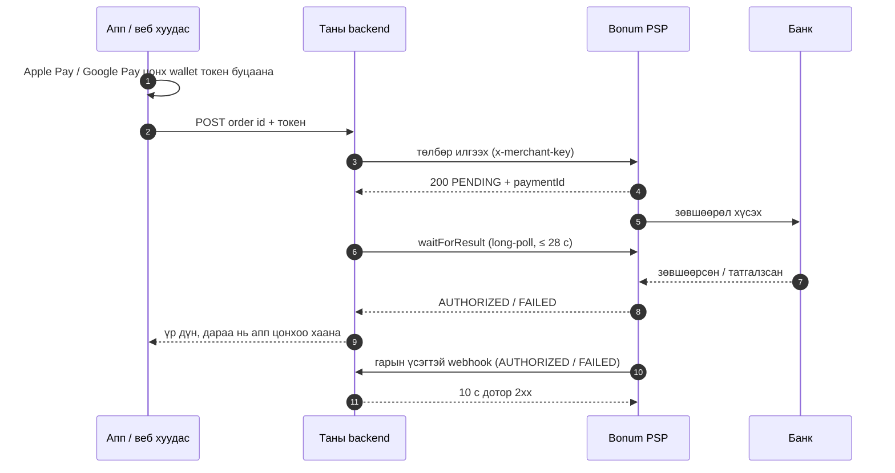

# bonum-psp

[English](./README.md) | **Монгол**

[](https://www.npmjs.com/package/bonum-psp)
[](https://github.com/Jack-infinite/bonum-psp/actions/workflows/ci.yml)
[](./LICENSE)

**Bonum PSP V2**-д зориулсан TypeScript SDK: Apple Pay болон Google Pay төлбөрийг серверээсээ
илгээж, банкны хариуг авч, Bonum-ын webhook-уудыг баталгаажуулна.

- [Боломжууд](#боломжууд) · [Суулгах](#суулгах) ·
  [V2 хэрхэн ажилладаг](#bonum-v2-хэрхэн-ажилладаг-вэ) · [Хурдан эхлэх](#хурдан-эхлэх) ·
  [Apple Pay](#apple-pay-ийн-урсгал) · [Google Pay](#google-pay-ийн-урсгал)
- [Webhook](#webhook-ууд) · [Idempotency болон тулгалт](#idempotency-болон-тулгалт) ·
  [Алдаа](#алдаа-боловсруулах) · [Тохиргоо](#тохиргооны-лавлах)
- [Тест](#интеграцаа-тестлэх) · [Туннель](#туннель-ашиглан-webhook-ийг-локал-орчинд-тестлэх) ·
  [Аюулгүй байдал](#аюулгүй-байдлын-тэмдэглэл) ·
  [Signature mismatch?](#signature-mismatch-алдааг-шийдвэрлэх) ·
  [Түгээмэл асуулт](#түгээмэл-асуултууд)

## Боломжууд

- **V2-ийн таван endpoint бүгд, төрөлжсөн (typed):** Apple Pay болон Google Pay төлбөр илгээх,
  `paymentId` эсвэл таны order id-аар хайх, мөн банкны хариуг хүлээдэг long-poll.
- **Webhook баталгаажуулалт:** тогтмол хугацаанд (constant-time) харьцуулдаг HMAC-SHA256, replay
  халдлагаас хамгаалах 300 секундын цонх, төрөлжсөн үйл явдлууд, нууц түлхүүр солих (rotation).
- **Бэлэн webhook handler-ууд:** нэг Fetch API handler (Next.js, Hono, Cloudflare Workers, Bun,
  Deno) болон Express adapter (Express 4 ба 5).
- **Тестийн туслахууд:** өөрийн тестэд зориулсан бодитой үйл явдлууд болон зөв гарын үсэгтэй
  webhook-ууд.
- **Найдвартай HTTP:** timeout, `AbortSignal`-аар цуцлах, backoff бүхий retry. Bonum `order_id`-г
  idempotency түлхүүр гэж үздэг тул илгээлтийг дахин оролдох нь аюулгүй.
- **Юу хийхийг хэлдэг алдаанууд:** тогтвортой `code` утгатай тусгай классууд бөгөөд мессеж нь
  дараагийн алхмыг хэлдэг.
- **Runtime dependency огт байхгүй.** Зөвхөн ESM, бүрэн type declaration-тай.

## Суулгах

```bash
npm install bonum-psp
# or: pnpm add bonum-psp · yarn add bonum-psp · bun add bonum-psp
```

## Шаардлага

- **Node.js 22.12 эсвэл түүнээс хойшхи хувилбар.** Node 22.12+ дээр CommonJS төслүүд ч
  `require('bonum-psp')` ашиглаж чадна. SDK зөвхөн Web стандартын API (`fetch`, Web Crypto,
  `AbortSignal`) ашигладаг тул Bun, Deno, Cloudflare Workers болон Vercel Edge дээр ч ажиллахаар
  бүтээгдсэн. CI нь Node 22, 24, 26 дээр тест ажиллуулдаг.
- **Зөвхөн сервер талд.** Мерчант түлхүүр нууц тул `new BonumClient()` браузерт ажиллахаас
  татгалздаг. Таны апп эсвэл веб хуудас _таны_ backend-тэй харилцаж, зөвхөн таны backend
  Bonum-тай харилцана. (Bonum-ын өөрийн зарим JavaScript жишээ API-г браузераас шууд дууддаг. Тэр
  хэсгийг бүү хуулаарай.)

## Bonum V2 хэрхэн ажилладаг вэ

Төлбөр илгээхэд банкны хариу шууд ирдэггүй. Bonum wallet токеныг хүлээн аваад тэр даруй `PENDING`
гэж хариулж, банкнаас ар талд нь асуудаг. Хариу танд зэрэг ажилладаг хоёр замаар ирнэ:

- **Await endpoint:** банк хариулах хүртэл таны backend хүсэлтийг (28 с хүртэл) нээлттэй барина.
  Wallet цонхыг бодит үр дүнгээр хаахад үүнийг ашигла.
- **Webhook:** Bonum таны серверт гарын үсэгтэй үйл явдлыг POST хийнэ. Wallet цонхноос ялгаатай нь
  энэ нь хэрэглэгч хуудсан дээр үлдэх эсэхээс хамаардаггүй бөгөөд Bonum үүнийг дахин илгээдэг.



Төлөвүүд:

| Төлөв        | Утга                                    | Юу хийх                                                                                 |
| ------------ | --------------------------------------- | --------------------------------------------------------------------------------------- |
| `PENDING`    | Хүлээн авсан, банк хараахан хариулаагүй | "Боловсруулж байна" гэж харуул. **Энэ бүтэлгүйтэл биш.** Захиалгыг хэзээ ч бүү биелүүл. |
| `AUTHORIZED` | Зөвшөөрөгдсөн, мөнгийг түр хаасан       | Захиалгыг (нэг удаа) биелүүл.                                                           |
| `FAILED`     | Татгалзсан эсвэл боловсруулалтын алдаа  | `failureReason`-ийг харуул. Хэрэглэгч шинэ order id-аар дахин оролдож болно.            |

## Хурдан эхлэх

```ts
import { BonumClient } from 'bonum-psp';

// Reads BONUM_MERCHANT_KEY, BONUM_ENV and (optionally) BONUM_WEBHOOK_SECRET from the environment.
const bonum = new BonumClient();

const payment = await bonum.payments.getByOrderId('ORD-1001');
console.log(payment.status); // 'PENDING' | 'AUTHORIZED' | 'FAILED'
```

| Хувьсагч               | Юунд хэрэглэгддэг                                                                                                           |
| ---------------------- | --------------------------------------------------------------------------------------------------------------------------- |
| `BONUM_MERCHANT_KEY`   | API-ийн бүх дуудлага (`x-merchant-key` header). Bonum таныг холбогдох (onboarding) үед олгоно.                              |
| `BONUM_ENV`            | `sandbox` (`https://testpsp.bonum.mn`) эсвэл `production` (`https://psp.bonum.mn`). **Заавал:** SDK хэзээ ч таамагладаггүй. |
| `BONUM_WEBHOOK_SECRET` | Webhook баталгаажуулалт. Таныг webhook URL-ээ бүртгүүлэхэд Bonum олгоно.                                                    |

Эдгээрийн оронд бүх утгыг option болгон дамжуулж болно.
[Тохиргооны лавлах](#тохиргооны-лавлах) хэсгийг үзнэ үү.

## Apple Pay-ийн урсгал

1. Таны апп эсвэл веб хуудас Apple Pay цонхыг харуулна. Хэрэглэгч зөвшөөрөхөд `PKPaymentToken`
   хүлээн авна (Apple Pay JS: `event.payment.token`).
2. Токен болон order id-г өөрчлөлгүйгээр таны backend руу POST хийнэ.
3. Таны backend дүнг шийдэж, төлбөрийг илгээгээд, цонх нээлттэй байдаг ойролцоогоор 30 секундэд
   багтах нэг нийт хугацааны хязгаар (deadline) дотор банкны хариуг хүлээнэ.
4. Апп цонхыг хаана: `AUTHORIZED` бол амжилттай, `FAILED` бол бүтэлгүй гэж. Цонх зөвхөн амжилт,
   бүтэлгүйтэл хоёрыг л мэддэг тул Bonum-ын зааварт байдгийн адил `PENDING` үед ч бүтэлгүй гэж
   хаана. Дараа нь апп өөрийн "боловсруулж байна" дэлгэцийг харуулж, захиалгын эцсийн үр дүнг
   webhook шийднэ. `PENDING` төлбөрийг бүтэлгүйтсэн гэж хэрэглэгчид хэзээ ч бүү хэл: тэр амжилттай
   болж магадгүй бөгөөд хэрэглэгч дахин төлж ч магадгүй.

```ts
import {
  type ApplePayPaymentToken,
  BonumClient,
  BonumValidationError,
  isBonumError,
} from 'bonum-psp';
import express from 'express';

const bonum = new BonumClient();
const app = express();
// Register the webhook route (see below) before this, so it still gets the raw body.
app.use(express.json());

app.post('/payments/apple-pay', async (req, res) => {
  const { orderId, token } = req.body as { orderId: string; token: ApplePayPaymentToken | string };
  const order = await findOrder(orderId); // your database: the amount comes from here, never the app
  if (order === undefined) {
    res.status(404).json({ error: 'unknown_order' });
    return;
  }

  // One deadline for submit + wait, inside the time the wallet sheet stays open.
  const deadline = Date.now() + 25_000;
  const signal = AbortSignal.timeout(25_000);
  try {
    const submission = await bonum.payments.submitApplePay(
      { orderId: order.id, token, amount: order.amount },
      { signal, timeoutMs: 8_000 },
    );
    await savePaymentId(order.id, submission.paymentId);

    const waitMs = Math.max(1, Math.min(20_000, deadline - Date.now() - 2_000));
    const result = await bonum.payments.waitForResult(submission, { waitMs, signal });
    res.json({ status: result.status, failureReason: result.failureReason });
  } catch (error) {
    if (error instanceof BonumValidationError) {
      res.status(400).json({ error: 'invalid_request', field: error.field });
      return;
    }
    // A timeout or network error leaves the outcome unknown: keep the order PENDING and let the
    // webhook or your reconciliation job settle it. Never tell the customer it failed.
    console.error('Bonum submission problem:', isBonumError(error) ? error.code : error);
    res.status(202).json({ status: 'PENDING' });
  }
});
```

`token` нь `PKPaymentToken` объект эсвэл түүний JSON string байж болно. Mobile bridge-үүд ихэвчлэн
string дамжуулдаг бөгөөд SDK түүнийг parse хийнэ. Токен Bonum руу яг хүлээн авсан хэлбэрээрээ
илгээгдэнэ. Apple Pay-ийн хүсэлтэд валют байдаггүй: валют токеноос ирдэг. Энэ серверийн бүрэн,
type шалгалттай хувилбар [`examples/express`](https://github.com/Jack-infinite/bonum-psp/tree/main/examples/express) хавтсанд бий.

## Google Pay-ийн урсгал

Урсгал нь ижил. Апп Google Pay-ийн үр дүнгээс `paymentData.paymentMethodData.tokenizationData.token`
string-ийг аваад таны backend руу илгээнэ. Дараа нь таны backend валютыг заана. Тэр нь `MNT`, `USD`,
`EUR` эсвэл `JPY` байх ёстой:

```ts
const submission = await bonum.payments.submitGooglePay(
  { orderId: order.id, token, currency: 'MNT', amount: order.amount },
  { signal, timeoutMs: 8_000 },
);
const result = await bonum.payments.waitForResult(submission, { waitMs, signal });
```

Apple Pay-ийнхтэй ижил deadline болон алдааны боловсруулалтыг ашигла. Wallet-уудыг өөрсдийг нь
тохируулах ажил (Apple merchant ID, домэйн баталгаажуулалт, Google Pay-ийн мерчант бүртгэл) энэ
SDK-ийн хүрээнд ордоггүй: Bonum-ын wallet-ийн зааврыг дагаарай.

## Webhook-ууд

Та Bonum-д **HTTPS** webhook URL бүртгүүлнэ (тэдний хянах самбараар эсвэл дэмжлэгийн багаар
дамжуулан), Bonum танд гарын үсэг зурах нууц түлхүүрийг өгнө. Таны endpoint дараахыг хийх ёстой:

1. Хүсэлтийн **түүхий (raw)** body-г унш: parse хийгээд дахин serialize хийсэн объектыг биш, яг
   тэр байтуудыг.
2. Өөр юу ч хийхээс өмнө гарын үсгийг шалга. SDK нь `X-PSP-Signature`-ийг (`v1=<hex>`,
   `` `${timestamp}.${rawBody}` `` дээрх HMAC-SHA256) болон `X-PSP-Timestamp` таны цагаас 300
   секундээс илүү зөрөөгүй эсэхийг шалгадаг.
3. **10 секундэд 2xx хариу** өг. Bonum бусад бүх хариуг амжилтгүй хүргэлт гэж үзэж, нийт тав
   хүртэл удаа оролдоно: тэр даруй, дараа нь ойролцоогоор 1 минут, 5 минут, 30 минут, 2 цагийн
   дараа. Үүний дараа үр дүнг зөвхөн хайлт (lookup) л сэргээж чадна.
4. Үйл явдлыг хадгалаад хариулж, удаан ажлыг (имэйл, захиалга биелүүлэх) ар талд хий. Давхардсан
   хүргэлтэд 4xx биш, 200 хариу өг.

Доорх handler-ууд таны өмнөөс хариулдаг: баталгаажуулалтад тэнцээгүй webhook-д 400
`{ "error": "<reason>" }`, таны `onEvent` алдаа шидвэл 500 (ингэснээр Bonum дахин оролдоно), бусад
үед 200. Энэ SDK-д хараахан мэдэгдээгүй төрлийн, зөв гарын үсэгтэй үйл явдал ч `"ignored": true`-тэй
200 авдаг тул Bonum түүнийг эцэс төгсгөлгүй дахин илгээхгүй.

```ts
import type { BonumWebhookEvent } from 'bonum-psp';

async function saveEvent(event: BonumWebhookEvent): Promise<void> {
  // event.eventType is 'AUTHORIZED' | 'FAILED'; TypeScript narrows on it.
  // Dedupe and store it; see "Idempotency and reconciliation".
}
```

### Express 5

```ts
import express from 'express';
import { BonumClient } from 'bonum-psp';
import { expressWebhookHandler } from 'bonum-psp/express';

const bonum = new BonumClient();
const app = express();

// Before any app-wide express.json(): that would parse the body, and the signature could no
// longer be checked.
app.post(
  '/webhooks/bonum',
  express.raw({ type: 'application/json' }),
  expressWebhookHandler({ webhooks: bonum.webhooks, onEvent: saveEvent }),
);

app.use(express.json());
```

Adapter-т `express`-ийн type хэрэггүй бөгөөд Express 4-тэй ч ажиллана. Body аль хэдийн parse
хийгдсэн бол засах аргыг нэрлэсэн `BonumConfigError`-ийг `next()` руу дамжуулна. Үр дүн нь 500 тул
засвар deploy хийгдэх хүртэл Bonum дахин оролдсоор байна. Зөвхөн webhook баталгаажуулах уу?
`expressWebhookHandler({ onEvent })` нь `BONUM_WEBHOOK_SECRET`-ийг уншдаг бөгөөд мерчант түлхүүр
шаарддаггүй.

### Next.js App Router

```ts
// app/api/webhooks/bonum/route.ts
import { BonumWebhooks } from 'bonum-psp';
import { saveEvent } from '@/lib/events';

let handler: ((request: Request) => Promise<Response>) | undefined;

export function POST(request: Request): Promise<Response> {
  // Created on the first request rather than at import time, so `next build` runs without
  // BONUM_WEBHOOK_SECRET.
  handler ??= new BonumWebhooks().createHandler({ onEvent: saveEvent });
  return handler(request);
}
```

Route handler-ууд хөндөгдөөгүй `Request`-ийг хүлээн авдаг тул body-parser тохируулах шаардлагагүй.
Жишээг [`examples/nextjs-app-router`](https://github.com/Jack-infinite/bonum-psp/tree/main/examples/nextjs-app-router) хавтаснаас үзнэ үү.

### Hono

```ts
import { Hono } from 'hono';
import { BonumWebhooks } from 'bonum-psp';

const handler = new BonumWebhooks().createHandler({ onEvent: saveEvent });
const app = new Hono();

app.post('/webhooks/bonum', (c) => handler(c.req.raw)); // don't read the body before this
```

Cloudflare Workers дээр нууц мэдээлэл орчны хувьсагч биш, binding хэлбэрээр ирдэг тул нууц
түлхүүрийг шууд дамжуулна: `new BonumWebhooks({ secret: c.env.BONUM_WEBHOOK_SECRET })`.

### Fastify

Fastify анхдагчаар бүх route-ын JSON-ийг parse хийдэг. Webhook route-д өөрийн plugin scope өгч,
түүхий байтуудыг зөвхөн тэр route-д хадгална:

```ts
import Fastify from 'fastify';
import { BonumWebhookError, BonumWebhooks } from 'bonum-psp';

const webhooks = new BonumWebhooks();
const app = Fastify();

app.register(async (scope) => {
  // Applies to routes in this plugin only: JSON bodies stay raw Buffers here.
  scope.addContentTypeParser('application/json', { parseAs: 'buffer' }, (_req, body, done) => {
    done(null, body);
  });

  scope.post('/webhooks/bonum', async (request, reply) => {
    try {
      const event = await webhooks.verify(request.body as Buffer, request.headers);
      await saveEvent(event);
      return { received: true };
    } catch (error) {
      if (!(error instanceof BonumWebhookError)) throw error; // 500: Bonum retries
      if (error.reason === 'unsupported_event_type') return { received: true, ignored: true };
      return reply.code(400).send({ error: error.reason });
    }
  });
});
```

### NestJS

Nest-ийн raw body дэмжлэгийг асаагаад `req.rawBody`-г шалгана:

```ts
// main.ts
const app = await NestFactory.create(AppModule, { rawBody: true });
```

```ts
// bonum-webhook.controller.ts
import { BadRequestException, Controller, HttpCode, Post, type RawBodyRequest, Req } from '@nestjs/common';
import type { Request } from 'express';
import { BonumWebhookError, BonumWebhooks } from 'bonum-psp';

@Controller('webhooks/bonum')
export class BonumWebhookController {
  private readonly webhooks = new BonumWebhooks();

  @Post()
  @HttpCode(200)
  async receive(@Req() req: RawBodyRequest<Request>) {
    if (req.rawBody === undefined) throw new Error('Create the app with { rawBody: true }.');
    try {
      const event = await this.webhooks.verify(req.rawBody, req.headers);
      await saveEvent(event);
      return { received: true };
    } catch (error) {
      if (!(error instanceof BonumWebhookError)) throw error; // 500: Bonum retries
      if (error.reason === 'unsupported_event_type') return { received: true, ignored: true };
      throw new BadRequestException({ error: error.reason });
    }
  }
}
```

### Бусад framework

`webhooks.verify(rawBody, headers)` нь түүхий body-г `string`, `Uint8Array` (Node-ийн `Buffer`)
эсвэл `ArrayBuffer` хэлбэрээр авна. Header нь `Headers` объект эсвэл Node-ийн `req.headers` байж
болно. Энэ нь төрөлжсөн үйл явдлыг буцаадаг, эсвэл юу буруу байсныг `reason`-доо хэлдэг
`BonumWebhookError` шиддэг. Fetch API runtime-уудад `webhooks.verifyRequest(request)` body-г таны
өмнөөс уншдаг бөгөөд `webhooks.createHandler()` бол бүрэн handler.

## Idempotency болон тулгалт

Үйл явдал бүр нэгээс олон удаа ирж, заримдаа огт ирэхгүй байж болно гэж тооцож төлөвлө. Хоёр
түвшний хамгаалалт ашигла:

1. **Хүргэлтүүдийн давхардлыг `webhookId`-аар шүү** (unique index ашиглан). Давтан хүргэлт 200
   авах бөгөөд дахин боловсруулагдахгүй.
2. **Төлбөр бүрийн төлөвийн шилжилт нэг л удаа болох ёстой.** Төлбөрийг `PENDING`-ээс нөхцөлт
   update-ээр гаргаж, тэр update ямар нэг зүйл өөрчилсөн үед л захиалгыг биелүүл. Retry хийхэд
   `webhookId` хэвээр үлдэх эсэхийг Bonum-ын баримт бичиг тодорхой хэлдэггүй. Түүнээс гадна нэг
   хариу танд webhook, `waitForResult` болон хайлтаас ямар ч дарааллаар ирж болно.

**Тулгалтын ажил (reconciliation job)** webhook огт ирээгүй үеийн цоорхойг нөхнө, жишээ нь таван
оролдлогын турш таны сервер унтарсан байсан бол. Тэр нь хэдэн минут тутамд `PENDING` хэвээр байгаа
төлбөрүүдийг хайж, ижил нөхцөлт update-ийг хэрэгжүүлнэ.

MongoDB ашиглавал:

```ts
import { type BonumWebhookEvent, BonumClient, type PaymentStatus } from 'bonum-psp';
import { MongoClient, MongoServerError } from 'mongodb';

interface OrderDoc {
  orderId: string;
  paymentId: string | null; // saved when the submission returns
  status: PaymentStatus;
  submittedAt: Date | null;
}

const bonum = new BonumClient();
const db = new MongoClient(process.env.MONGODB_URL ?? 'mongodb://localhost:27017').db('shop');
const events = db.collection<BonumWebhookEvent>('bonum_webhook_events');
const orders = db.collection<OrderDoc>('orders');
await events.createIndex({ webhookId: 1 }, { unique: true });

/** Moves a payment out of PENDING once. Returns true only for the call that did it. */
async function settle(paymentId: string, status: 'AUTHORIZED' | 'FAILED'): Promise<boolean> {
  const { modifiedCount } = await orders.updateOne(
    { paymentId, status: 'PENDING' },
    { $set: { status } },
  );
  return modifiedCount === 1;
}

/** The webhook's onEvent. */
export async function saveEvent(event: BonumWebhookEvent): Promise<void> {
  try {
    await events.insertOne(event); // level 1: the unique index rejects a repeated delivery
  } catch (error) {
    if (error instanceof MongoServerError && error.code === 11000) return; // duplicate: answer 200
    throw error; // 500: Bonum retries
  }
  // Level 2: whichever of webhook, waitForResult or the job comes first wins; the rest are no-ops.
  if ((await settle(event.paymentId, event.status)) && event.status === 'AUTHORIZED') {
    await enqueueFulfilment(event.orderId); // slow work happens elsewhere
  }
}

/** Run every few minutes. */
export async function reconcilePendingPayments(): Promise<void> {
  const cutoff = new Date(Date.now() - 10 * 60_000);
  for await (const order of orders.find({ status: 'PENDING', submittedAt: { $lt: cutoff } })) {
    if (order.paymentId === null) continue; // see below
    const payment = await bonum.payments.get(order.paymentId);
    if (payment.status === 'PENDING') continue;
    if ((await settle(payment.paymentId, payment.status)) && payment.status === 'AUTHORIZED') {
      await enqueueFulfilment(payment.orderId);
    }
  }
}
```

SQL-д нөхцөлт update нь
`UPDATE orders SET status = $1 WHERE payment_id = $2 AND status = 'PENDING'` бөгөөд өөрчлөгдсөн
мөрийн тоог шалгана.

Хэрэв таны сервер илгээх болон `paymentId`-г хадгалах хооронд зогссон бол төлбөрийг
`bonum.payments.getByOrderId(orderId)`-ээр олно. Ижил `order_id`-г дахин илгээх нь ч аюулгүй: Bonum
хоёр дахь удаа мөнгө татахын оронд анхны төлбөрийг буцаадаг. SDK сүлжээний алдааны дараа илгээлтийг
дахин оролддог шалтгаан нь ч энэ. Төлбөрийн оролдлого бүрт **шинэ** `order_id` ашигла.

## Алдаа боловсруулах

SDK-ийн шиддэг бүх алдаа `BonumError`-оос удамшдаг бөгөөд тогтвортой `code`-той:

| Класс                          | `code`                | Хэзээ                                                                                    |
| ------------------------------ | --------------------- | ---------------------------------------------------------------------------------------- |
| `BonumConfigError`             | `invalid_config`      | Түлхүүр, орчин, base URL эсвэл нууц түлхүүр дутуу эсвэл буруу; браузерт ашигласан.       |
| `BonumValidationError`         | `invalid_request`     | Таны оролт ямар ч хүсэлт илгээгдэхээс өмнө шалгалтад тэнцээгүй. `field` түүнийг нэрлэнэ. |
| `BonumConnectionError`         | `connection_error`    | Сүлжээний алдаа (retry-уудын дараа).                                                     |
| `BonumTimeoutError`            | `timeout`             | `timeoutMs` дотор хариу ирээгүй (retry-уудын дараа).                                     |
| `BonumUnexpectedResponseError` | `unexpected_response` | SDK танихгүй хэлбэртэй 2xx, эсвэл redirect.                                              |
| `BonumAPIError`                | `api_error`           | Бусад HTTP алдаа. `status`, `body`, `method`, `path` талбартай.                          |
| ↳ `BonumBadRequestError`       | `api_error`           | 400: Bonum аль нэг талбарыг хүлээн аваагүй.                                              |
| ↳ `BonumAuthenticationError`   | `api_error`           | 401: мерчант түлхүүр байхгүй, буруу эсвэл идэвхгүй болсон.                               |
| ↳ `BonumNotFoundError`         | `api_error`           | 404: ийм төлбөр байхгүй, эсвэл өөр мерчантад хамаарна.                                   |
| ↳ `BonumRateLimitError`        | `api_error`           | 429. Bonum `Retry-After` илгээсэн бол `retryAfterMs` түүнийг агуулна.                    |
| ↳ `BonumServerError`           | `api_error`           | 5xx. Bonum-ын дэмжлэгийн баг `paymentId`-г асууна.                                       |
| `BonumWebhookError`            | `webhook_error`       | Webhook баталгаажуулалтад тэнцээгүй. `reason` шалтгааныг хэлнэ.                          |

```ts
import { BonumAPIError, BonumNotFoundError, isBonumError } from 'bonum-psp';

try {
  await bonum.payments.get(paymentId);
} catch (error) {
  if (error instanceof BonumNotFoundError) return null;
  if (error instanceof BonumAPIError) logger.error({ status: error.status, body: error.body });
  else if (isBonumError(error)) logger.error({ code: error.code, message: error.message });
  throw error;
}
```

**Retry.** Сүлжээний алдаа, timeout, 429, 500, 502, 503, 504-ийг `maxRetries` удаа хүртэл дахин
оролдоно. Хүлээлтүүд full jitter бүхий exponential backoff (500 мс суурь, 8 с дээд хязгаар)
ашигладаг бөгөөд `Retry-After`-ийг 60 с хүртэл хүндэтгэнэ. Бусад 4xx хариуг хэзээ ч дахин
оролддоггүй. Илгээлтийг ч дахин оролддог бөгөөд энэ нь `order_id`-ийн idempotency-ийн ачаар
аюулгүй. `waitForResult`-ийг хэзээ ч дахин оролддоггүй, учир нь wallet цонх хүлээж чадахгүй.

Алдааны мессеж болон `toString()` хэзээ ч мерчант түлхүүр эсвэл webhook-ийн нууц түлхүүрийг
агуулдаггүй бөгөөд хариуны body-г тайрч богиносгодог.

## Тохиргооны лавлах

`new BonumClient(options?)`:

| Option                    | Анхдагч                      | Тэмдэглэл                                                                                          |
| ------------------------- | ---------------------------- | -------------------------------------------------------------------------------------------------- |
| `merchantKey`             | env `BONUM_MERCHANT_KEY`     | Заавал, аль нэг эх сурвалжаас. Эхэн, төгсгөлийн хоосон зайг арилгана.                              |
| `environment`             | env `BONUM_ENV`              | `'sandbox'` эсвэл `'production'`. Заавал: анхдагч утга байхгүй.                                    |
| `webhookSecret`           | env `BONUM_WEBHOOK_SECRET`   | String, эсвэл солих (rotation) үед массив. Зөвхөн `bonum.webhooks`-д хэрэгтэй.                     |
| `baseUrl`                 | орчны URL                    | Proxy-д зориулсан. `https:` байх ёстой; энгийн `http:` зөвхөн `localhost`, `127.0.0.1`, `[::1]`-д. |
| `timeoutMs`               | `15000`                      | Оролдлого бүрт.                                                                                    |
| `maxRetries`              | `2`                          | 0–10.                                                                                              |
| `fetch`                   | глобал `fetch`               | Хяналт (instrumentation) эсвэл тестэд.                                                             |
| `userAgent`               | байхгүй                      | `bonum-psp/<version>`-ийн ард нэмэгдэнэ, жишээ нь `my-shop/1.4.0`.                                 |
| `dangerouslyAllowBrowser` | `false`                      | Зөвхөн браузертэй төстэй test runner-уудад. Түлхүүрийг браузерт хэзээ ч бүү илгээ.                 |
| `sleep`, `random`         | жинхэнэ timer, `Math.random` | Retry-г детерминист болгох тестийн hook.                                                           |

Хүсэлтийн method бүр сүүлийн аргумент болгон `options`-ийг авна:
`{ signal?: AbortSignal; timeoutMs?: number }`.
`waitForResult(paymentIdOrSubmission, { waitMs?, signal? })` нь 1–28 000 мс (анхдагч 25 000)
хүлээж, `{ paymentId, status, failureReason, timedOut }`-ээр resolve болно. `timedOut: true` үед
`status: 'PENDING'` байна.

`new BonumWebhooks(options?)`-д мерчант түлхүүр хэрэггүй:

| Option             | Анхдагч                    | Тэмдэглэл                                                                            |
| ------------------ | -------------------------- | ------------------------------------------------------------------------------------ |
| `secret`           | env `BONUM_WEBHOOK_SECRET` | String, эсвэл солих үед хуучин, шинэ нууц түлхүүрийг хоёуланг нь хүлээн авах массив. |
| `toleranceSeconds` | `300`                      | Зөвшөөрөгдөх цагийн зөрүү, 1–3600.                                                   |
| `now`              | `Date.now`                 | Тестийн hook.                                                                        |

Баталгаажуулалт ямар ч хүсэлт илгээгдэхээс өмнө хийгддэг: order id 1–128 тэмдэгт, branch id 1–64
тэмдэгт, дүн хамгийн багадаа 0.01, аравтын хоёроос илүүгүй оронтой, payment id нь UUID байх ёстой.

Туслах функцууд: `isTerminalStatus(status)` нь `AUTHORIZED` болон `FAILED`-д true буцаана.
`normalizeCurrency(code)` нь ISO тоон кодыг үсгэн код руу хөрвүүлдэг (`'496'` → `'MNT'`; мөн USD,
EUR, JPY), учир нь Bonum-ын хайлтууд аль ч хэлбэрийг мэдээлж болно. SDK өөрөө `currency`-г хэзээ ч
дахин бичдэггүй. `PaymentStatus.AUTHORIZED`, `WalletType.APPLE_PAY`, `CurrencyCode.MNT` зэрэг
тогтмолууд үсгийн алдаанаас хамгаална.

## Интеграцаа тестлэх

`bonum-psp/testing` нь бодитой үйл явдлуудыг үүсгэж, Bonum-ын адилаар гарын үсэг зурдаг тул webhook
route-оо Bonum-гүйгээр тестлэх боломжтой:

```ts
import { createTestWebhookEvent, signTestWebhook } from 'bonum-psp/testing';
import { expect, test } from 'vitest';
import { POST } from './app/api/webhooks/bonum/route';

test('accepts a signed AUTHORIZED webhook', async () => {
  process.env.BONUM_WEBHOOK_SECRET = 'test_webhook_secret';
  const { body, headers } = await signTestWebhook({
    payload: createTestWebhookEvent({ orderId: 'ORD-1001' }), // AUTHORIZED by default
    secret: 'test_webhook_secret',
  });
  const request = new Request('http://localhost/api/webhooks/bonum', {
    method: 'POST',
    body,
    headers,
  });
  const response = await POST(request);
  expect(response.status).toBe(200);
});
```

`createTestWebhookEvent({ eventType: 'FAILED' })` нь `failureReason`-тэй татгалзсан үйл явдал
өгнө. Ажиллаж буй серверийг хуурамч гарын үсэг, хуучирсан timestamp, давхардсан хүргэлт зэргийг
оруулан эхнээс нь дуустал тестлэхийн тулд AI кодлох агентаасаа
[`bonum-psp-mcp`](https://github.com/Jack-infinite/bonum-psp/blob/main/packages/mcp/README.mn.md)-ийн `send_test_webhook` хэрэгслийг ашиглаарай.

Bonum-ын sandbox (`BONUM_ENV=sandbox`) өөрийн мерчант түлхүүр болон webhook-ийн нууц түлхүүртэй.
Bonum-ын wallet-ийн жишээн дэх тайлбаруудаас харахад sandbox төлбөр ч бодит картаас мөнгө татаж
магадгүй тул өөрийн картаар тестийн төлбөр илгээхээс өмнө Bonum-аас лавлаарай.

## Туннель ашиглан webhook-ийг локал орчинд тестлэх

Bonum таны webhook-д HTTPS-ээр хандах ёстой тул локал серверээ туннель ашиглан интернэтэд нээнэ.
[Cloudflare Tunnel](https://developers.cloudflare.com/tunnel/) ашиглавал (quick tunnel-д бүртгэл
хэрэггүй):

```bash
cloudflared tunnel --url http://localhost:3000
# → https://<random-name>.trycloudflare.com
```

Дараа нь `https://<random-name>.trycloudflare.com/webhooks/bonum`-ийг Bonum-д **sandbox**-ийн
webhook URL болгон бүртгүүлнэ. Quick tunnel ажиллуулах бүрд шинэ нэр авдаг бөгөөд URL бүртгүүлэх
нь Bonum-аар дамждаг тул урт хугацаандаа тогтмол hostname-тэй нэрлэсэн туннель (named tunnel) бага
ажил шаарддаг. Туннель ажиллаж байх үед тэр порт дээрх бүх зүйл нийтэд нээлттэй тул ажлаа
дуусмагц зогсоогоорой.

## Аюулгүй байдлын тэмдэглэл

- Мерчант түлхүүр болон webhook-ийн нууц түлхүүрийг кодонд, аппын багцад, log-д эсвэл issue-д
  биш, нууц мэдээллийн менежер (secret manager) эсвэл орчны хувьсагчид хадгал. SDK тэдгээрийг
  private талбарт хадгалдаг: `JSON.stringify(client)`, `util.inspect` эсвэл алдааны мессежид
  харагддаггүй.
- Webhook бүрийг үйлдэл хийхээсээ өмнө шалгаж, татгалзсан webhook-д зөвхөн шалтгааныг нэрлэсэн
  энгийн 400 хариу өг.
- Дүнг сервер дээрээ шийд. Аппаас ирсэн дүнд хэзээ ч бүү итгэ.
- SDK мерчант түлхүүрийг зөвхөн тохируулсан base URL руу илгээдэг. Redirect хэзээ ч дагадаггүй
  бөгөөд Bonum-ын буцаасан `statusUrl` эсвэл `awaitUrl`-ийг хэзээ ч дууддаггүй; URL бүрийг
  баталгаажуулсан `paymentId`-аас өөрөө бүрдүүлдэг.
- Нууц түлхүүрийг зогсолтгүйгээр солихын тулд хоёуланг нь дамжуул:
  `webhookSecret: [newSecret, oldSecret]`.
- Эмзэг байдлын талаар нууцаар мэдэгдэнэ үү; [SECURITY.mn.md](https://github.com/Jack-infinite/bonum-psp/blob/main/SECURITY.mn.md)-г үзнэ үү.

## "signature mismatch" алдааг шийдвэрлэх

`reason: 'signature_mismatch'`-тэй `BonumWebhookError` нь таны шалгасан байтууд, нууц түлхүүр
эсвэл timestamp Bonum-ын гарын үсэг зурсан зүйлээс ялгаатай гэсэн үг. Дараах дарааллаар шалга:

1. **Body parse хийгдсэн.** JSON parser body-г объект болгож, дараа нь ямар нэг зүйл түүнийг дахин
   serialize хийсэн. Объектыг өөрийг нь дамжуулбал `body_not_raw` шидэгдэх бөгөөд тэр нь таны
   framework-д тохирох засварыг нэрлэдэг.
2. **Глобал `express.json()` (эсвэл `bodyParser.json()`) webhook route-аас өмнө ажилладаг.**
   Webhook route-ыг түрүүлж бүртгэ, эсвэл глобал parser-аас хас.
3. **Буруу нууц түлхүүр эсвэл орчин.** Sandbox болон production өөр өөр нууц түлхүүртэй. Нууц
   түлхүүр webhook илгээсэн орчных мөн эсэхийг шалга.
4. **Ямар нэг зүйл body-г дахин бичдэг:** API gateway, WAF, кодчиллыг өөрчилдөг эсвэл JSON-ийг
   pretty-print хийдэг middleware. Байтуудыг таны аппад яг ирсэн хэлбэрээр нь шалга.
5. **Цагийн зөрүү** mismatch биш, `timestamp_out_of_tolerance` болж илэрдэг. Серверийнхээ цагийг
   NTP-ээр тааруул.

MCP сервер ашиглаж байгаа бол барьж авсан body болон header дээр `verify_webhook` ажиллуулахыг
агентаасаа хүс. Тэр нь яг шалтгааныг тайлбарлах бөгөөд `ignoreTimestamp` нь хуучин бичлэгийг
дахин шалгах боломж олгоно.

## Түгээмэл асуултууд

**Миний mobile апп Apple Pay-ийн токеныг өөр хэлбэрээр илгээдэг.** Bonum Apple-ийн
`PKPaymentToken`-ийг JSON хэлбэрээр хүлээдэг:

```jsonc
{
  "paymentData": {
    "data": "…",
    "signature": "…",
    "header": { "publicKeyHash": "…", "ephemeralPublicKey": "…", "transactionId": "…" },
    "version": "EC_v1"
  },
  "paymentMethod": { "displayName": "Visa 1234", "network": "Visa", "type": "debit" },
  "transactionIdentifier": "…"
}
```

Apple Pay JS танд энэ объектыг `event.payment.token` болгон өгдөг. Native iOS кодонд
`PKPayment.token.paymentData` нь зөвхөн `paymentData` хэсгийг JSON байт хэлбэрээр агуулдаг.
Объектыг түүнийг тойруулан бүрдүүл: `paymentData`-г parse хийж, токены бусад property-оос
`paymentMethod` болон `transactionIdentifier`-ийг нэм. Зарим React Native library `paymentData`-г
base64 string хэлбэрээр дамжуулдаг; эхлээд JSON болгон decode хий. JSON key-үүдийн бичлэгийг
(жишээ нь snake_case руу хөрвүүлдэг middleware-ээр) хэзээ ч бүү өөрчил, токеныг хоёр удаа бүү
encode хий. Ямар нэг зүйл дутуу бол `submitApplePay` хүлээгдэж буй хэлбэрийг тайлбарласан
`BonumValidationError` шиднэ.

**Миний төлбөр яагаад `PENDING` хэвээр байна вэ?** Банк хараахан хариулаагүй байна. Энэ
тохиолдолд `waitForResult` нь `timedOut: true` буцаах бөгөөд webhook араас нь ирнэ. Хэдэн минутын
дотор аль нь ч ирэхгүй бол таны тулгалтын ажил төлбөрийг шалгаж шийднэ.

**Bonum-ыг браузер эсвэл аппаас дуудаж болох уу?** Үгүй. Мерчант түлхүүр нийтэд ил болно. Апп
wallet токеныг таны backend руу илгээж, таны backend Bonum-ыг дуудна.

**Bonum V1-ийг дэмждэг үү?** Үгүй. Зөвхөн `/api/v2` endpoint-уудыг хэрэгжүүлсэн.

**Энэ албан ёсны уу?** Үгүй. Энэ бол BONUM ХХК-тай холбоогүй, тэдний дэмжлэггүй, бие даасан
нээлттэй эхийн төсөл.

## Лиценз

[MIT](./LICENSE) © 2026 Jack Infinite
